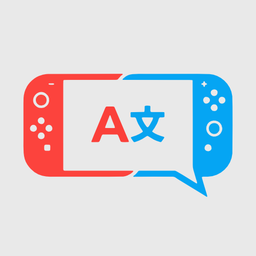
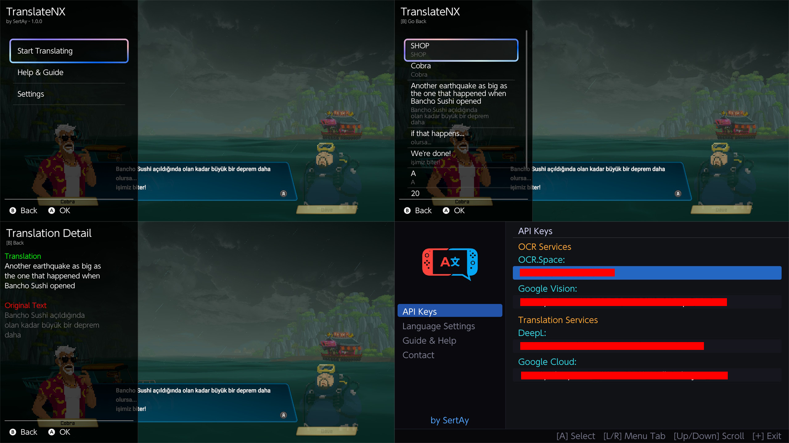
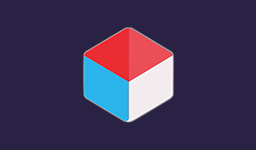

CURRENTLY NOT WORKING, PLEASE DO NOT TRY TO USE THE APPLICATION

<h1 align="center">TranslateNX </h1>

  

  ---
    
  

  <b>(EN)</b> TranslateNX is a revolutionary real-time translation overlay for the Nintendo Switch. It seamlessly reads text directly from your games and translates it on-the-fly, breaking language barriers without needing any game-specific patches or mods.

  ---

  <b>(TR)</b> TranslateNX, Nintendo Switch için devrim niteliğinde anlık çeviri aracıdır. Oyunlardaki metinleri doğrudan okuyup anında çevirerek, oyun yamalarına veya modlarına ihtiyaç duymadan dil engellerini ortadan kaldırır.
  

   

 &nbsp;&nbsp; 

---

## (EN) Setup and Usage Guide

### ✨ Features
* **Real-time Translation:** Translate on-screen game text instantly.
* **OCR Technology:** Directly reads text from the screen, no game mods required.
* **Wide Language Support:** Support for 104 different languages.
* **Practical Use:** Translate quickly without leaving the game using the UltraHand Overlay menu.
* **Multiple Service Options:** Supports Google Cloud Vision, OCR.space, DeepL, Google Cloud Translate, and MyMemory.

  

### ⚠️ Step 1: Critical Prep (Required)
To prevent your console from crashing, you must increase the **UltraHand memory limit**:
1. Open the UltraHand menu.
2. Press `+` to open settings, then go to **System**.
3. Change **Overlay Memory** from **4MB to 8MB**.

**IMPORTANT: If you continue to experience crashes, please turn off the enabled modules in Sysmodules.**

### 💾 Step 2: Installation
**Requirements:** You MUST have [nx-ovlloader](https://github.com/ppkantorski/nx-ovlloader) and [Ultrahand-Overlay](https://github.com/ppkantorski/Ultrahand-Overlay) installed for this app to work!

**Method 1: Homebrew App Store (Automatic Installation)**
You can download and install the application directly on your Switch via the HB App Store.

   <a href="https://hb-app.store/switch/TranslateNX">
  
   
  <a href="https://apps.fortheusers.org/switch/TranslateNX">HB Store Download Link</a>

 

**Method 2: Manual Installation**
You can install the application by downloading it on your computer and transferring it to your SD card.
* Download the [latest release](https://github.com/sertay1/TranslateNX/releases) `.zip` file. Extract it and drag all the contents directly to the root of your SD card. The files are already placed in their correct folder paths.

### 🔑 Step 3: Getting API Keys
TranslateNX needs services to read (OCR) and translate text. For the best performance, we highly recommend using Google Cloud Vision for OCR and DeepL for Translation.

#### 🔍 OCR API Options
**1. Google Cloud Vision (1000 Uses/Month) — ⭐ RECOMMENDED**
* Go to [Google Cloud Vision](https://cloud.google.com/vision) and click "Try Vision AI Free" to complete registration.
* On the Cloud Vision API page, click the "Enable" button.
* Go to the **Credentials** tab on the left menu. Select **Create Credentials > API Key** from the top.
* Name your API. In the *Select API restrictions* section, choose **Cloud Vision API**, click OK, and then Create. Your API key will appear in seconds.

**2. OCR.space (500 Uses/Day) — Alternative**
* Register at [OCR.space Free Key](https://ocr.space/OCRAPI).
* Click the confirmation link sent to your email. You will receive a second email with your API key seconds after confirming.

#### 🌍 Translation API Options
**1. DeepL (1,000,000 Characters Once) — ⭐ RECOMMENDED**
*(Note: 1 million characters will last a very long time. You can create a new free account when it runs out).*
* Sign up at [DeepL](https://www.deepl.com). Click your profile icon at the top right, then **Account**.
* Go to **API Plans** in the bottom left corner and subscribe to the free plan (it may ask for details but will not charge).
* Go to the **API Keys & Limits** tab and click **Create Key**.
* Name your API, select "All access", and click Create Key.

**2. Google Cloud Translate (500,000 Characters/Month) — Alternative**
*(Note: It may ask for card details and put a small hold during signup, but it is free as long as you stay within the quota).*
* Go to [Google Cloud Translate](https://cloud.google.com/translate) and register.
* Enable the **Cloud Translation API**.
* Go to **Credentials > Create Credentials > API Key**.
* Name your API, select Cloud Translation API from restrictions, and click Create.

**3. MyMemory (5,000 Characters/Day) — Fallback**
This is built-in. No API key is required. Simply select it from the app settings if you need a quick fallback.

#### 🤖 AI API Options
**1. Puter AI — 
* Go to [Puter.com](https://puter.com) and create a free account.
* Once logged in, open the developer dashboard to generate your API key.
* Puter AI offers generous limits for executing AI-based translations, providing context-aware and natural-sounding results.

**2. Google Gemini AI — Alternative**
* Go to [Google AI Studio](https://aistudio.google.com) and sign in with your Google account.
* Click on **"Get API key"** from the left menu and create a new key.
* Gemini provides extremely fast and smart context-based translations for complex game scenarios.

### 📝 Step 4: Entering API Keys
You can enter your API keys into the app using one of two methods:
* **Method 1 (Via Switch):** Open the TranslateNX app from the Hbmenu and type your API keys directly into the app interface.
* **Method 2 (Via PC - Easier):** Connect your Switch to your PC. Open the `SD:/config/translate/config.ini` file. Paste your API keys next to the respective fields, save, and put the file back on your Switch.

### 🎮 Step 5: How to Use
1. **Open UltraHand:** While in-game, swipe your finger from the left edge of the screen to the right, or press **L + R + D-Pad Down + Right Stick**.
2. **Launch TranslateNX:** Select TranslateNX from the list. *(Tip: You can press Y while hovering over it to set it as a shortcut).*
3. **Configure Settings:** Go to Settings. Select the OCR and Translation APIs you acquired.
4. **Set Languages:** 
   * **Source:** The original language of the game.
   * **Target:** Your language.
5. **Start Translating:** When there is text on the screen, open the TranslateNX menu and press **"Start Translating"**.
*(Note: The first translation might take a bit longer. Speed depends on the API and your internet connection).*

## 📄 License / Lisans

Copyright (c) 2026 **SertAy**.  
This project is available for personal and non-commercial use with mandatory author attribution. Claiming authorship, unauthorized redistribution, or selling this software is strictly prohibited. Please see the [LICENSE](LICENSE) file for details.
